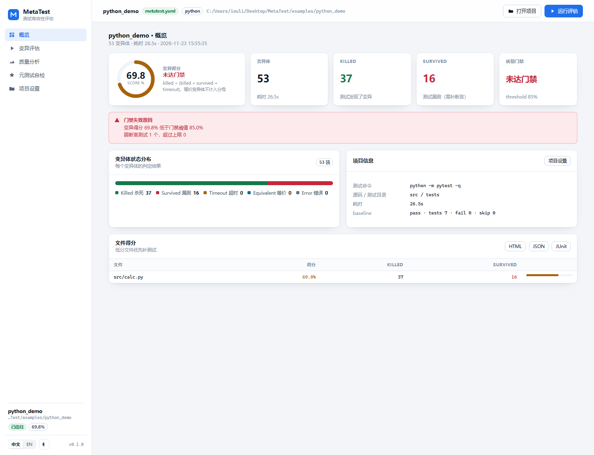

# MetaTest

**测试有效性评估与元测试平台** —— 变异测试驱动的测试有效性评估 + 元测试自检 + 多语言适配器协议。

普通测试工具回答"产品有没有 bug"。MetaTest 回答三个更上层的问题：

1. **现有测试套件是否有效？** 测试通过不代表测试能发现问题（变异测试）。
2. **测试套件质量是否在退化？** 覆盖率、断言强度、flaky、冗余需要持续评估。
3. **测试工具本身是否可信？** 用已知答案的基准项目验证平台自身判断是否正确（元测试自检，`metatest selftest`）。

对应 PRD 的核心概括：**一个平台、三类能力（变异测试 / 测试质量分析 / CI 集成）、一个差异点（元测试自检）**。

---

## 快速开始

```bash
pip install -e .            # 本仓库开发安装（C 变异推荐：pip install -e ".[c]"）
metatest selftest           # 先自检：17 个已知答案基准项目，验证平台自身可信
cd examples/python_demo
metatest allow              # 显式信任该目录配置（用户级登记，仓库内容无法自我授权）
metatest run                # 变异测试 + 报告（.metatest/report/report.html）
echo $?
```

### 图形界面：本地控制台

不想记命令时，用浏览器界面完成同样的评估（与 CLI 共用同一引擎与判定语义）：

```bash
metatest ui                # 自动开浏览器，默认 http://127.0.0.1:8777
metatest ui --project examples/python_demo
python scripts/build_exe.py   # 打包成单文件 dist/MetaTest.exe（双击即用）
```

界面含五个页面：**概览**（得分环 / 状态分布 / 文件得分 / 报告下载）、**变异评估**
（选项 + 实时日志 + 变异体明细筛选）、**质量分析**（flaky / 弱断言 / 重复 / 三轴评分）、
**元测试自检**（17 个基准逐项结论）、**项目设置**（init / 信任登记 / 配置在线编辑）。
中英双语、明暗主题、纯离线静态资源。详见 [docs/web-console.md](docs/web-console.md)。



### CLI 退出码（PRD FR-09）

| 退出码 | 含义 |
|-------|------|
| 0 | 成功且达到质量门禁阈值 |
| 1 | 质量门禁失败（变异得分低于阈值 / flaky / 弱断言超限） |
| 2 | 平台/配置错误（配置无效、环境缺失、基线测试失败、不可信配置） |
| 3 | 元测试自检失败（平台自身不可信，CI 必须失败） |

### 常用命令

```bash
metatest init [dir]                      # 生成 metatest.yaml（探测语言 + 推断布局 + 登记信任）
metatest run [--incremental --diff-ref main]   # 全量 / 增量变异评估
metatest run --test-selection            # 测试关联筛选：只跑覆盖变异行的测试（仅 Python/pytest）
metatest selftest [--list]               # 元测试自检
metatest flaky --runs 3 --isolate        # flaky 检测 + 隔离分类（孤立 flaky vs 顺序依赖）
metatest quality [--strict]              # 弱断言 / 重复测试 / flaky 分析
metatest report --results results.json --format html --out report.html
metatest ci github                       # 输出官方 GitHub Actions 模板
metatest ci gitlab                       # 输出官方 GitLab CI 模板
metatest ui [--project DIR --port N]     # 启动本地 Web 控制台（浏览器界面）
metatest plugins template                # 导出插件模板（新增变异算子/适配器）
metatest allow / deny                    # 登记或撤销对某配置的信任（用户级存储）
```

完整说明见 [docs/cli.md](docs/cli.md)。

## 核心概念

### 变异测试

对源码生成微小变异（如 `>` → `>=`、删除语句、返回值替换），对每个变异体运行测试套件：

| 状态 | 含义 |
|------|------|
| killed | 测试失败 —— 测试发现了变异（好） |
| survived | 测试通过 —— **漏测**（报告会给出代码位置与上下文） |
| timeout | 执行超时（单独统计） |
| equivalent | 等价变异（人工标记/启发式提示，不计入得分） |
| error | 构建/执行错误（不计入得分但需报告） |

`Mutation Score = killed / (killed + survived + timeout)`，等价变异体从分母排除。

### 元测试自检（差异点）

`metatest selftest` 运行内置的 17 个已知答案基准项目，验证平台不会把失败误报为通过、把跳过误判为成功：

| 类型 | 已知答案 |
|------|---------|
| py_must_fail / c_must_fail | 测试必失败 → 平台必须判 fail |
| py_must_pass / c_must_pass / command_must_pass | 测试必通过 → 平台必须判 pass |
| py_skip / py_all_skipped | 跳过 ≠ 通过 → 必须判 pass_with_skips / all_skipped |
| py_timeout | 必超时 → 平台必须判 timeout 并终止进程 |
| py_weak_assert | 弱断言必须被质量分析标记 |
| py_flaky | 交替失败必须被 flaky 检测识别 |
| py_mutant_kill / c_mutant_kill / py_mutant_survive | 指定变异必须被杀死 / 存活 |
| py_equivalent_manual | 人工标记的等价变异 → equivalent（不计入得分分母） |
| py_equivalent_suspect | dunder 内返回值变异 → 必须带“疑似等价”启发式标记 |
| c_lexical_guard | 宏/字符串/注释区域零变异体、零 error（词法误伤防护） |

自检失败 → 退出码 3 → CI 应当失败（平台自身不可信时的一切结论都不可信）。

### 适配器协议（多语言接入）

统一接口：`detect() / prepare() / generate_mutants() / run_tests() / parse_result() / cleanup()`

- **python**：AST 变异 + pytest/unittest（JUnit XML 统一结果输入）
- **c**：tree-sitter 变异引擎（无依赖时词法级回退），支持 gcc / Make / CMake+CTest
- **command**：任意项目命令级接入 —— 提供 build/test 命令与结果格式即可获得 flaky 检测、结果校验与报告；配置 `mutation.rule_files` 后还能做**规则化变异**（universalmutator 思路，任意语言）
- **策略注册表**：按语言自动选择变异策略（C: llvm_ir 插件插槽 → tree_sitter → fallback），CLI `--strategy` 可显式指定，报告含选择链与分引擎得分（`engine_scores`）
- **第三方**：通过插件模板新增变异算子或适配器（见 [docs/adapters.md](docs/adapters.md)）

### 测试质量分析（FR-07）

- **flaky 检测**：同一测试重复运行 N 次，统计不稳定率
- **弱断言**：只执行不断言 / 断言恒真 / 自比较断言 / 无条件跳过
- **重复测试**：归一化 AST 相同的用例
- **高覆盖率低变异得分**：覆盖率只说明"执行了"，变异得分才说明"验证了"
- **C 质量分析**（tree-sitter 弱断言检测）与**三轴质量评分**（adequacy / redundancy /
  maintainability，sixth_sense 式框架）进入报告
- 所有发现以"可操作建议"形式输出到报告

## 架构

```
metatest/
├── cli/            # CLI 入口（init/run/selftest/flaky/quality/report/plugins/ci/ui）
├── core/           # 调度引擎、沙箱、缓存、增量筛选、质量分析
├── adapters/       # python / c / command 适配器 + 插件注册
├── mutators/       # python AST 变异器、c tree-sitter 变异器
├── metatests/      # 已知答案基准项目库（17 个，见 docs/selftest.md）
├── plugins/        # 插件加载与模板
├── report/         # HTML / JSON / JUnit XML 报告
└── web/            # 本地 Web 控制台：HTTP API + SSE 日志 + 前端静态资源
```

> 软件化交付：`metatest ui` 启动本地控制台，`python scripts/build_exe.py` 产出
> `dist/MetaTest.exe`（PyInstaller 单文件，约 25 MB）。控制台复用 CLI 的全部判定逻辑，
> 不引入第二套语义。

性能设计（PRD 2.2）：增量模式（只评估改动相关变异，文件级 + 函数级）· 并行执行 ·
每变异体独立沙箱目录 · 超时终止 · 结果缓存（未变更代码直接复用，二次运行秒级完成）。

## 兼容性

Windows 10/11、Linux、macOS 均可运行（Python 3.10+）。Windows 上已实测
CLI 全链路、自检 17/17 与打包版 exe。

Python 项目里 `test_cmd` 写成 `python -m pytest` 时，MetaTest 会把裸 `python`
解析成「能 import pytest 的解释器」（多 Python 环境下 PATH 上的 `python` 常常不是装了
测试依赖的那个，这是"基线测试 0 个用例"的头号原因）；写了绝对路径则原样使用。
需要固定某个解释器时：`metatest python --set <路径>`（用户级绑定，或界面「项目设置 → Python 解释器」）。

## 安全（重要）

MetaTest 会执行 metatest.yaml 中配置的命令。信任判定原则：**仓库内容无法自我授权**
（攻击者可以随仓库提交带 `trust: true` 的配置，因此该字段已不再授予执行权）：

- 信任存储在**用户级** `~/.metatest/trusted.json`（键 = 配置绝对路径，值 = 配置内容指纹），
  由 `metatest init` 自动登记、`metatest allow` 显式登记、`metatest deny` 撤销；
- 配置文件被改动（哪怕一行注释）后信任自动失效，需重新确认；
- 其它情况默认 **拒绝执行命令**（退出码 2），可用 `--allow-commands` 或
  `METATEST_ALLOW_COMMANDS=1`（CI）一次性放行；
- 所有测试命令在独立沙箱目录中执行，不污染工作区，超时后强制终止进程树。

## 文档

- [验收记录](docs/acceptance.md)（对照 PRD 第 11 节逐项验证）
- [配置说明](docs/configuration.md)
- [CLI 说明](docs/cli.md)
- [适配器协议与插件](docs/adapters.md)
- [元测试自检](docs/selftest.md)
- [CI 集成示例](docs/ci.md)
- [限制与边界](docs/limitations.md)
- [本地 Web 控制台（软件化交付）](docs/web-console.md)
- [AI 读取闭环（GitHub MCP + 本地 AST 索引）](docs/mcp-ai-loop.md)
- [真实缺陷基准库（BugsInPy / MetaFL）](docs/bugbench.md)
- [生态借鉴图谱（universalmutator / Mull / flakeguard / sixth_sense）](docs/ecosystem.md)

## 路线图

- ✅ M0-M3（本仓库）：Python CLI + Python/C 变异 + 调度/沙箱/缓存 + 报告 + CI 退出码 + 元测试自检 + flaky/弱断言/重复检测 + 插件模板
- ✅ 软件化：本地 Web 控制台（中英双语 / 明暗主题 / SSE 实时日志）+ 单文件 exe 打包
- ⏳ M4：Java/JS/Go 深度语法级变异适配器、Web 报告服务、LLM 辅助等价变异判定、SaaS 托管（见 PRD 4.3，暂未实现）
