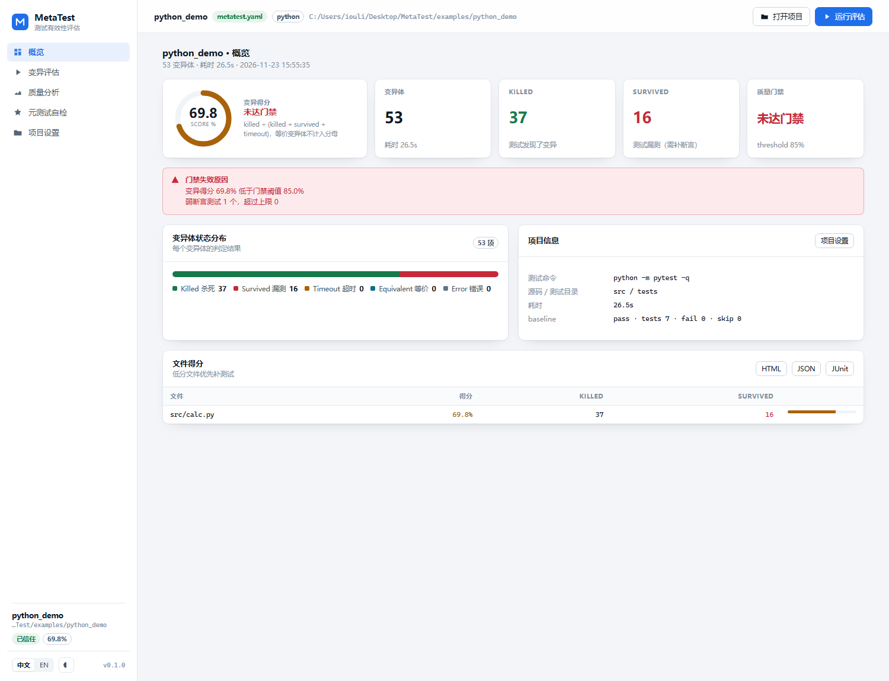
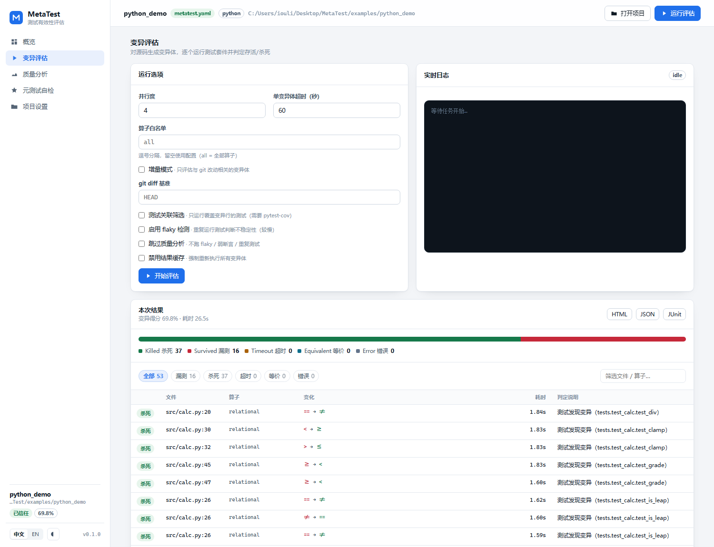
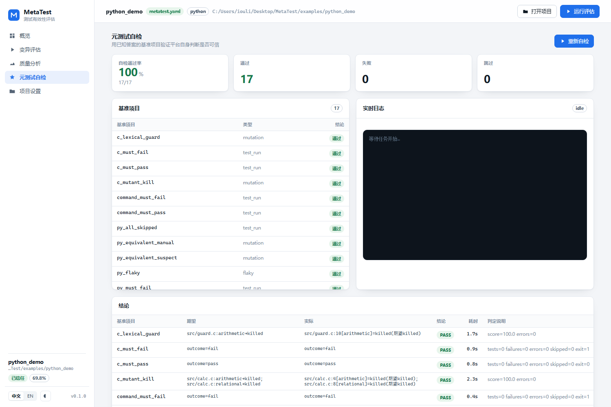

# 本地 Web 控制台（软件化交付）

MetaTest 除了 CLI，还提供一个**本地浏览器控制台**：不用记命令，打开界面就能选项目、
跑变异评估、看漏测位置、做质量分析和元测试自检。控制台与 CLI **共用同一套引擎与判定
语义**，看到的分数、状态、报告与命令行完全一致。

```
┌─ 启 动 ────────────────────────────────────────────────┐
│  metatest ui                    # 已 pip install 时     │
│  python -m metatest.web         # 源码目录下            │
│  双击 MetaTest.exe              # 打包版（见下）        │
└────────────────────────────────────────────────────────┘
```

默认只监听 `127.0.0.1`，自动挑选 8777 起的空闲端口，并自动打开浏览器。

| 参数 | 说明 |
|------|------|
| `--port N` | 指定端口（默认自动选择） |
| `--host H` | 监听地址（默认 `127.0.0.1`，不建议改） |
| `--no-browser` | 不自动开浏览器（服务器/远程场景） |
| `--project DIR` | 启动后直接打开该目录 |

## 界面导览



| 页面 | 用途 |
|------|------|
| **概览** | 变异得分环、KPI（变异体 / killed / survived / 门禁）、状态分布条、文件得分表、引擎可信度；一键跳转报告（HTML / JSON / JUnit） |
| **变异评估** | 运行选项（并行度、超时、增量、测试关联筛选、flaky、算子白名单、缓存）+ 实时日志与进度 + 本次结果与变异体明细（按状态筛选、按文件/算子搜索） |
| **质量分析** | flaky 测试、弱断言、重复测试、高覆盖率低得分、三轴评分（充分性 / 冗余 / 可维护性）、可操作建议 |
| **元测试自检** | 17 个已知答案基准项目的逐项结论（期望 vs 实际）、通过率、日志；自检失败会明确提示「平台自身不可信」 |
| **项目设置** | 项目信息、命令信任登记/撤销、`metatest.yaml` 在线查看与编辑、历史报告入口、最近项目 |

界面支持**中英双语**切换与**明暗主题**，纯静态资源、离线可用（无 CDN、无外部字体）。





### 任务与日志

* 变异评估 / 质量分析 / 自检都在后台队列中顺序执行（避免多个变异任务抢占 CPU，
  导致超时判定失真）。正在运行的任务会在顶部显示状态与 `exit N`。
* 日志通过 SSE 实时推送，按 `[done/total]` 行解析进度条；关闭页面不影响任务本身
  （任务在服务进程内，服务退出才中止）。

## 解释器绑定（多 Python 环境）

「测试命令跑起来却是 0 个用例」几乎都是解释器问题：`metatest.yaml` 写
`python -m pytest`，而 PATH 上的 `python` 不是装了 pytest 的那个。

* 自动探测：MetaTest 依次检查「该项目的绑定 → 自身解释器 → PATH 上的 python/python3/py
  → 常见安装位置（`py -0p` 列表、`%LOCALAPPDATA%\Programs\Python`、`C://Python3*` 等）」，
  并**实际 import pytest 验证**；
* 项目设置页有「Python 解释器」卡片，列出每个候选及其 pytest 状态，一键切换；
  选择存入用户级 `~/.metatest/interpreters.json`（按项目根目录），不改动仓库配置；
* 命令行同样支持：

```bash
metatest python                       # 列出候选与当前使用
metatest python --set D://Python//python.exe
metatest python --clear               # 恢复自动探测
```

## 安全模型

控制台会执行 `metatest.yaml` 里的命令，因此保留 CLI 的信任模型，并额外加了三道本地防护：

1. **仅回环监听 + Host 校验**：拒绝非 `127.0.0.1/localhost` 的 Host 头，防 DNS rebinding。
2. **写操作要求自定义请求头** `X-Metatest-Client: web`：跨站表单无法伪造，普通网页
   不能悄悄驱动本机执行命令。
3. **命令执行仍需显式确认**：配置未登记信任时，「开始评估」会先展示 `build_cmd` /
   `test_cmd` 并要求点击「信任并运行」；信任存储仍是用户级
   `~/.metatest/trusted.json`（绑定配置内容指纹），**仓库内容无法自我授权**。
4. 报告文件读取被限制在项目的 `.metatest/report` 目录内（防路径穿越），
   `/api/report` 只服务该目录下的文件。

## 打包为可执行程序

```bash
python -m pip install pyinstaller
python scripts/build_exe.py          # 产物：dist/MetaTest.exe（单文件，约 25 MB）
```

打包内容：`metatest` 全部子模块、前端静态资源 `metatest/web/static`、元测试基准项目库
`metatest/metatests`、插件模板；已安装的可选依赖（tree-sitter / coverage 等）会自动打入。

运行：双击 `MetaTest.exe`（控制台窗口会打印访问地址），或
`MetaTest.exe --port 8777 --no-browser`。

**打包版的解释器约束**：exe 内部没有独立的 `python.exe`，被测项目的测试命令仍需真实
解释器。MetaTest 会依次探测 `sys` 候选（PATH 上的 `python`、`python3`、`py`），
**优先选择能 `import pytest` 的那个**；都不满足时在日志里列出每个候选的检测结果并提示
在 `metatest.yaml` 里用绝对路径解释器。这样可避免最常见的问题——
「PATH 上的 python 不是装了 pytest 的那个」。

## 常见问题

| 现象 | 处理 |
|------|------|
| 基线测试 0 个用例 / 直接中止 | 见上：解释器或依赖问题。日志会打印 `[baseline] 命令未收集到任何测试用例` 与末行输出 |
| 端口被占用 | 默认自动挑空闲端口；也可 `--port` 指定 |
| 页面打不开 | 确认控制台窗口仍在运行；或 `--no-browser` 后手动访问窗口里打印的地址 |
| 想用团队共享 | 不要把 `--host` 改成 `0.0.0.0`：该服务没有鉴权，只面向本机单用户（PRD 明确 MVP 不做 SaaS） |

## 与 CLI 的一致性

界面每个动作最终都落到 CLI 参数（例如「增量 + diff 基准」→ `run --incremental --diff-ref`），
结果来自同一份 `.metatest/report/results.json`，退出码语义也一致
（0 通过 / 1 门禁失败 / 2 平台错误 / 3 自检失败），因此**界面里看到的通过与否，CI 里也是同样结论**。

> 说明：引擎自身产出的诊断日志与建议为中文（CLI 的一等公民语言）。英文界面会翻译
> 关键行（初始化、基线、得分、门禁、自检汇总），其余原文保留，便于排查时与命令行对齐。
